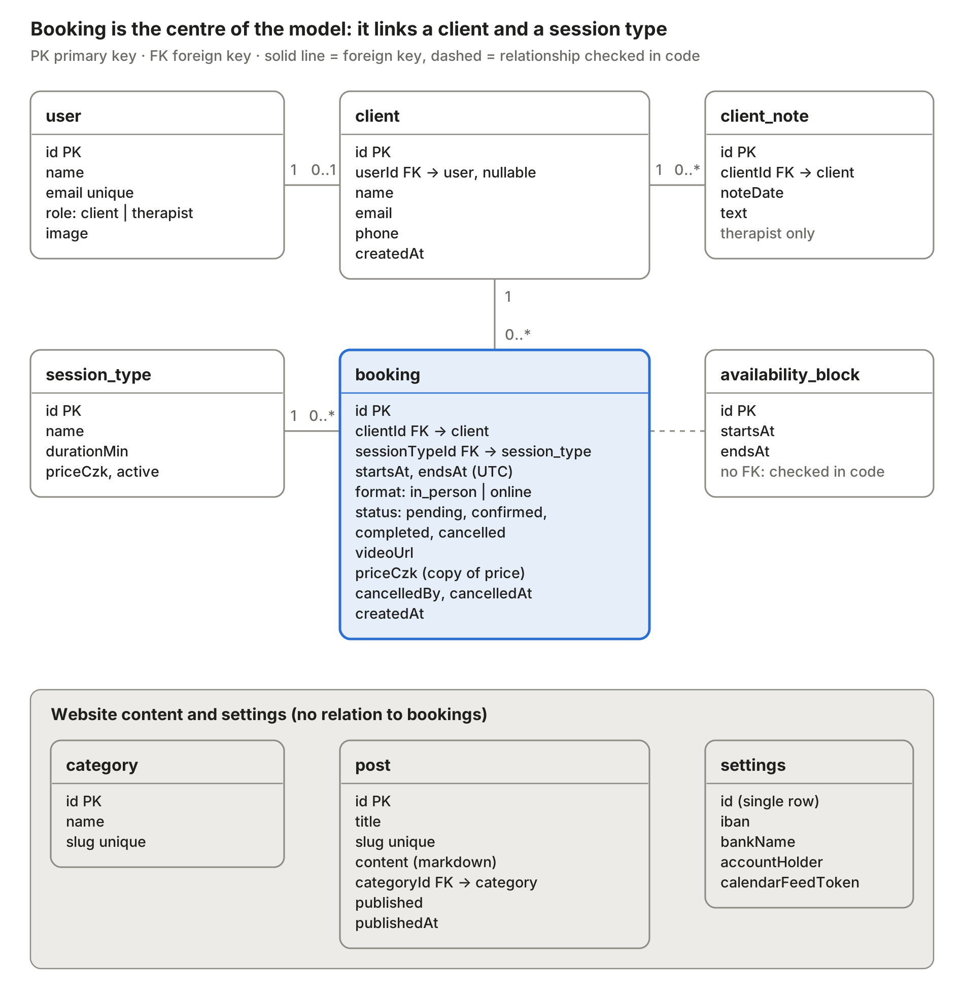

# Therapist Booking System Therapio

A web app for booking therapy sessions: visitors browse the public site, clients book and cancel sessions, and the therapist manages everything from an admin area.

School project for **PV247 TypeScript Full-Stack Web Development**.

## Roles

| Role              | Can do                                                                                                       |
| ----------------- | ------------------------------------------------------------------------------------------------------------ |
| Visitor           | Browse home, pricing and blog; send the contact form (delivered to the therapist by e-mail)                  |
| Client            | Sign in via SSO, book and cancel sessions, see upcoming and past bookings, see payment details and a QR code |
| Therapist (admin) | Manage availability, bookings, clients, prices and blog content                                              |

## Tech stack

Next.js (App Router, Server Actions) · TypeScript · Tailwind + shadcn/ui · Drizzle ORM + Turso (SQLite) · React Hook Form + Zod · TanStack Table / Query · next-auth (GitHub SSO) · Resend (e-mail) · Vercel

## Data model

Times are stored as UTC timestamps (shown in Europe/Prague), prices in CZK.

### Features

- [x] Next.js project with shadcn/ui
- [x] Project plan, data model
- [ ] Public site: home, pricing, blog, contact form
- [ ] SSO sign-in with client / therapist roles
- [ ] Availability blocks published by the therapist
- [ ] Booking: session type (own price), format (in person / online), time within a block
- [ ] Booking states: pending → confirmed → completed, or cancelled
- [ ] Client cancels up to 48 hours before the start
- [ ] Therapist confirms, cancels, reschedules and creates bookings (also for a client without an account)
- [ ] Video call link for online sessions
- [ ] E-mail notifications for the therapist and the client
- [ ] Session type prices, bank details and payment QR code
- [ ] Client list, client detail with session history, dated private notes
- [ ] Calendar overview and ICS calendar feed
- [ ] Blog with categories and a public/non-public setting

## Team

| Member | Area                                      |
| ------ | ----------------------------------------- |
| M      | Backend: auth, clients, blog data         |
| I      | Backend: bookings, e-mails, calendar feed |
| R      | Frontend: all pages and forms             |

## Workflow

Single `main` branch, feature branches named `<issue-number>-short-name`, every change goes through a pull request with one review. Work is tracked as GitHub issues.
